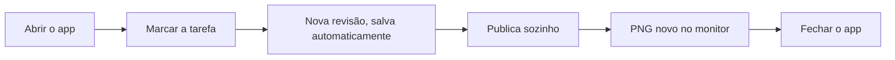

# 01 — Visão do produto

## O problema

O Windows permite um wallpaper por monitor, mas a experiência é limitada: as Configurações trocam a imagem
por um menu de contexto pouco visível, o modo de ajuste (preencher, ajustar, centralizar) é **um só para
todos os monitores**, e não há como compor nada nem voltar a uma versão anterior.

Isso pesa especialmente em uma configuração como esta, em que cada monitor tem uma forma diferente:

```text
                                      ┌─────────┐
┌────────────┬──────────────────────┐ │ Vertical│
│  Full HD   │      Ultrawide       │ │ 1080 x  │
│ 1920x1080  │  2560x1080 (primário)│ │  1920   │
└────────────┴──────────────────────┘ └─────────┘
```

## O que o app faz

1. Lista os monitores físicos conectados e deixa o usuário escolher **um**.
2. Coloca nesse monitor um wallpaper de um dos três tipos. Os outros monitores não mudam.
3. Lembra o que está em cada monitor, e consegue restaurar o wallpaper anterior.

## Princípios

### Extremamente leve

**Isto não é um Wallpaper Engine.** O wallpaper é uma imagem estática, e o Windows cuida dela sozinho.

- **Com o app fechado, o custo é zero:** nenhum processo, serviço, ícone na bandeja ou início com o Windows.
  (A única exceção é o modo animado, experimental e isolado.)
- **O wallpaper estático ou dinâmico não usa VRAM a mais** do que um wallpaper comum, porque é um.
- **Sem dependências desnecessárias.** A renderização usa o próprio WPF
  ([ADR 0005](adr/0005-renderizacao-com-wpf.md)).

### Só o app altera o wallpaper

Nada muda sozinho. Nenhuma atualização por horário, nenhum arquivo observado, nenhuma tarefa em segundo plano.

Daí vem uma consequência prática: como o app precisa ser aberto até para marcar uma tarefa, **ele tem que
abrir rápido**. Metas, e o que foi medido até agora:

| Meta | Valor proposto | Referência |
|---|---|---|
| Da abertura à janela utilizável | ≤ 1,5 s | **Cerca de 0,65 s** ([medido](04-integracao-windows.md#custo-de-abrir-o-app)) |
| Recompor e publicar | ≤ 1 s | Cerca de 0,9 s somando as medições: 0,5 s de renderização e 0,45 s do shell ([custo medido](04-integracao-windows.md#custo-de-trocar-o-wallpaper)) |
| Depois de fechar | 0 processos | Requisito, não meta |

### Saída irreversível, projeto recriável

O PNG entregue ao Windows é **plano e irreversível**: nada nele separa os itens. O que permite voltar atrás
é o **registro de alterações** do projeto, a partir do qual a composição pode ser refeita.

## Tipos de wallpaper

### Static

Uma imagem comum. O usuário escolhe o arquivo e como ela se ajusta ao monitor (preencher, ajustar,
centralizar, esticar). O app gera uma cópia na resolução exata do monitor e a aplica. Não há projeto nem
histórico.

### Dynamic

Uma composição que continua **editável pelo app** depois de aplicada. O Windows só recebe uma imagem estática
comum; o que a torna dinâmica é o projeto guardado pelo app.

Cada wallpaper dinâmico é uma pasta com os arquivos-fonte e o histórico completo. Ele tem um fundo e uma
lista de itens:

| Item | Exemplo de uso |
|---|---|
| **Imagem** | Um cheatsheet de uma linguagem, ou qualquer imagem escolhida por você, com posição, tamanho, rotação e opacidade. Com opção de tamanho real, para um cheatsheet continuar legível |
| **Checklist** | Lista de tarefas: adicionar, remover e marcar entradas, por um checkbox no app |

O ciclo de uso, por exemplo ao marcar uma tarefa:



Cada mudança entra no registro: o que foi adicionado, removido ou alterado. Dá para reverter o documento
inteiro a qualquer revisão, ou trazer de volta **um único item** de uma revisão antiga. Reverter nunca apaga
nada. Detalhes em [03 — Formato de projeto](03-formato-de-projeto.md).

"Dynamic" aqui significa *pode ser alterado pelo editor*, e não *muda sozinho com o tempo*.

### Animated — experimental

Um vídeo `.mp4` em loop atrás dos ícones do desktop, em um monitor. É a **única exceção** aos princípios acima,
e por isso é tratado como um **experimento**, com uma pergunta precisa: *quanta VRAM isso consome, e vale a
pena?* A resposta pode ser "não vale", e o experimento terá cumprido seu papel. O app funciona por inteiro
sem ele. Ver [05 — Experimento do modo animado](05-experimento-animado.md).

## Fora do escopo

| Fora do escopo | Por quê |
|---|---|
| Wallpapers interativos ou com efeitos em tempo real, como no Wallpaper Engine | Contraria o princípio de leveza |
| Processo residente, bandeja, início com o Windows (fora o modo animado) | Idem |
| Atualização automática (horário, slideshow, arquivos observados, dados da internet) | Só o app altera o wallpaper |
| Ferramentas de pintura e filtros | O app compõe itens; não é um editor de imagens |
| Perspectiva e máscaras | Nenhum exemplo de uso precisa disso. Pode ser reavaliado |
| Item de texto e realce de sintaxe | As referências serão imagens. Pode ser reavaliado depois |
| Imagens sorteadas pelo app | As imagens são sempre escolhidas pelo usuário; sortear sem animação ficaria estranho |
| Interagir clicando no próprio wallpaper | Exigiria um processo residente ([custo estimado](04-integracao-windows.md#clicar-no-próprio-wallpaper)). Pode ser reavaliado |
| Formatos de vídeo além de `.mp4`; áudio no vídeo | O modo animado é um experimento |
| HDR e cor de 10 bits | Tudo é processado em 8 bits sRGB, para manter o app simples |
| Modo "span" (uma imagem atravessando os monitores) | O objetivo é justamente o controle por monitor |
| Sincronização, nuvem, loja de wallpapers | Não pedido |

## Vocabulário

Os documentos e o código usam estes termos com significado exato:

| Termo | Definição |
|---|---|
| **Monitor** | Um monitor físico ativo. Identificado pelo *device path* do Windows, não pelo índice |
| **Canvas** | O tamanho em pixels do documento de um projeto dinâmico |
| **Documento** | O fundo mais a lista de itens: o estado completo de um wallpaper dinâmico |
| **Item** | Um elemento do documento: imagem ou checklist |
| **Asset** | Um arquivo-fonte importado para o projeto. Imutável |
| **Revisão** | Um estado completo e imutável do documento, com a descrição da mudança |
| **Head** | A revisão atual do projeto |
| **Renderizar** | Gerar um bitmap a partir de um documento. Sem efeitos colaterais |
| **Publicar** | Renderizar para um monitor e entregar o PNG ao Windows. Ação explícita, exceto ao marcar uma tarefa (Q3) |
| **Atribuição** | O registro de qual wallpaper está em qual monitor. Pertence à máquina, não ao projeto |

## Perguntas em aberto

Cada uma tem uma resposta assumida, com a qual os documentos foram escritos.

| # | Pergunta | Assumido | Se a resposta for outra |
|---|---|---|---|
| Q3 | Marcar uma tarefa no app deve publicar sozinho, ou é preciso clicar em "Publicar"? | Publicar sozinho: um checkbox no app faz a troca, em cerca de 0,9 s. As outras alterações, como mover um item, continuam pedindo "Publicar" | Um botão "Publicar" também para as tarefas. Não afeta o formato |
| Q4 | Um projeto deve poder ser publicado em um monitor de formato diferente do canvas? | Sim, ajustando a composição inteira na publicação, sem alterar as revisões | Se não, a tela de publicação só oferece monitores do mesmo tamanho |
| Q5 | O modo animado precisa voltar sozinho depois de reiniciar o PC? | Não, enquanto for experimento | Registro de inicialização com o Windows, só se o experimento for aprovado |

### Resolvidas

- **Imagens aleatórias:** são escolhidas pelo usuário. Sorteadas exigiriam animação para não ficarem estranhas.
- **Referências de linguagem:** arquivos do usuário, provavelmente imagens tipo cheatsheet. Por isso o item de
  texto saiu da primeira versão.
- **Clicar no próprio wallpaper:** a checklist é operada pelo app, enquanto o custo de um processo residente
  não compensar ([análise](04-integracao-windows.md#clicar-no-próprio-wallpaper)).
- **O que significa "colocar uma imagem dentro da outra"?** Na saída, é tudo um PNG plano e irreversível, sem
  camadas no desktop. No projeto, os itens continuam separados, e um registro de alterações permite reverter e
  recompor ([ADR 0004](adr/0004-composicao-recriavel.md)).
