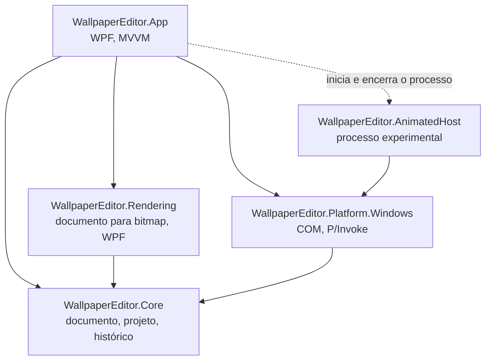
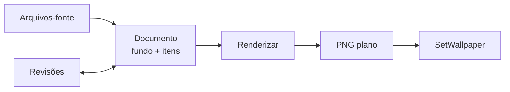
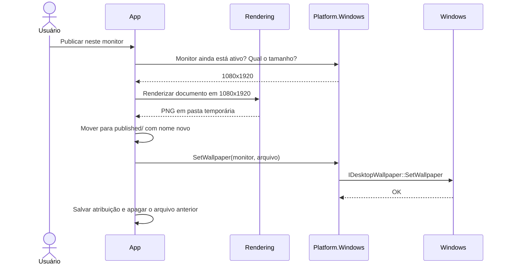
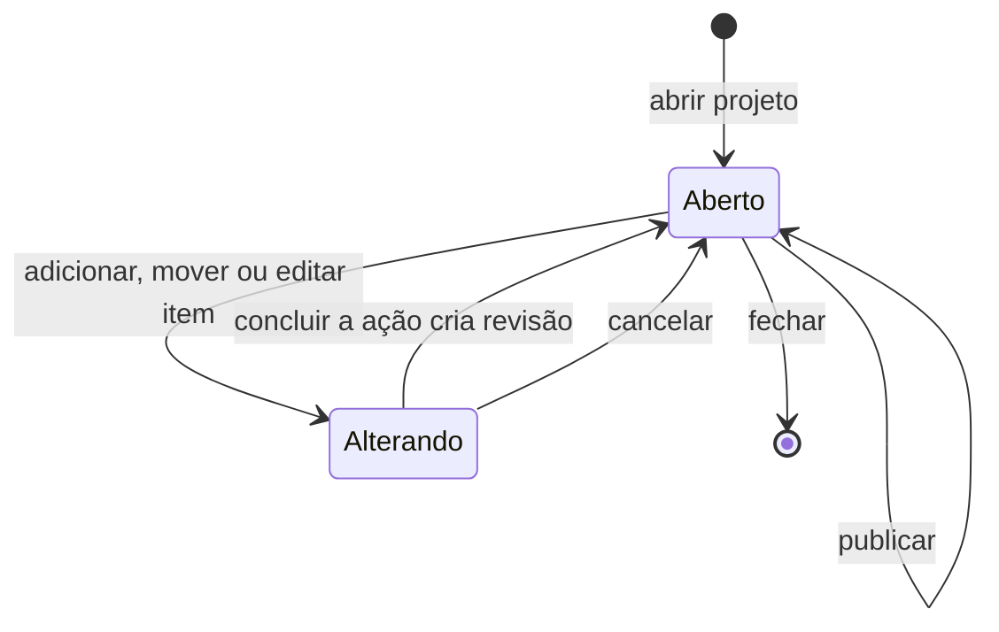
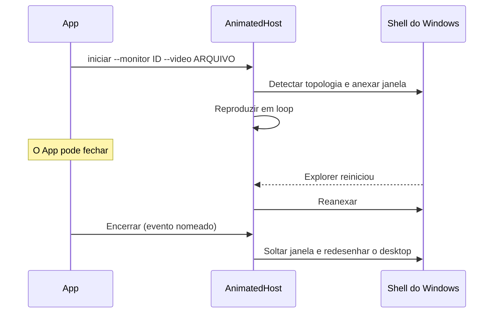

# 02 — Arquitetura

## A ideia central

O modelo da solução parte de uma observação: **o Windows mantém o wallpaper estático sozinho.** Depois da
chamada à API, o app pode fechar. Só o vídeo exige um processo vivo.

Por isso:

- Static e Dynamic terminam da mesma forma: uma imagem plana, entregue ao Windows. Nenhum dos dois deixa
  processo rodando.
- Animated é outro mundo, em outro processo, que pode ser removido sem afetar os demais.

## Projetos



| Projeto | Responsabilidade | Não pode |
|---|---|---|
| **Core** | Tipos (`Monitor`, `Project`, `Revision`, `Document`, itens), regras de histórico, leitura e escrita da pasta de projeto, interfaces (`IWallpaperService`, `IMonitorService`, `IWallpaperRenderer`) | Referenciar WPF, Win32 ou qualquer API de imagem |
| **Rendering** | Transformar um documento em bitmap e PNG; ajustar uma imagem ao monitor | Saber o que é um monitor do Windows; recebe apenas tamanhos em pixels |
| **Platform.Windows** | Falar com o Windows: enumerar monitores, aplicar wallpaper, ler estado, encontrar a janela do desktop | Conter regra de negócio |
| **App** | Janelas, editor, view models, composição das dependências | Chamar Win32 diretamente |
| **AnimatedHost** | Reproduzir um vídeo atrás dos ícones em um monitor | Depender do App, do Rendering ou de WPF |

Fora de `src/`, `tools/WallpaperEditor.Diagnostics` valida os comportamentos do Windows e mede custos, para que
tudo possa ser repetido em uma build futura. Ela usa o mesmo `Platform.Windows`, e só escreve no monitor vertical.

A direção das dependências é o que torna o projeto testável: o `Core` roda em testes sem nada do Windows, e o
`Rendering` não precisa de janela nem de monitor. A justificativa da divisão está no
[ADR 0002](adr/0002-divisao-do-projeto.md).

**Target frameworks:** `net10.0` para Core; `net10.0-windows` para App, Rendering e Platform.Windows;
`net10.0-windows10.0.19041.0` para AnimatedHost, que usa uma API WinRT.

**Publicação do app:** framework-dependent com ReadyToRun, para reduzir o tempo de abertura sem distribuir o
runtime inteiro. A confirmar por medição na Fase 3.

## O fluxo de dados

Tudo o que o app faz cabe neste caminho. Um wallpaper estático é apenas um documento sem itens e sem histórico:



## Fluxo: publicar



A ordem importa: o arquivo anterior só é apagado depois que o Windows aceitou o novo, e a atribuição só é
gravada depois do sucesso. Uma falha em qualquer etapa deixa o monitor como estava.

**Esse OK significa "agendado".** `SetWallpaper` retorna em 3 ms, e o shell trabalha por mais cerca de 450 ms
([custo medido](04-integracao-windows.md#custo-de-trocar-o-wallpaper)). `GetWallpaper` já informa o caminho novo
antes disso, então não serve para saber se a troca terminou.

As razões para pré-renderizar e usar nome novo a cada publicação estão no
[ADR 0003](adr/0003-pre-render-na-resolucao-nativa.md).

## Fluxo: editar um wallpaper dinâmico



- **Salvar é automático.** Toda ação concluída vira uma revisão, e não existe "salvar" nem alteração perdida.
- **Publicar é explícito, exceto ao marcar uma tarefa,** que já faz a troca (Q3 da
  [visão do produto](01-visao-do-produto.md#perguntas-em-aberto)). Nos outros casos, o head pode estar à frente
  do que está no monitor, e a tela mostra essa diferença de forma visível.
- **O histórico mostra as mudanças em texto,** como "Adicionou checklist Hoje" ou "Marcou tarefa", com miniatura
  gerada sob demanda em `cache/`.

## Fluxo: modo animado



Um processo por monitor animado. A troca de mensagens é a mínima possível: argumentos de linha de comando para
iniciar e um evento nomeado para encerrar.

## Estado do app

Duas categorias, separadas de propósito:

| Onde | O que | Por quê |
|---|---|---|
| Pasta do projeto (local escolhido pelo usuário) | Assets, revisões | Portátil: pode ser movida ou copiada para outra máquina |
| `%LOCALAPPDATA%\WallpaperEditor\` | Atribuições, arquivos publicados, logs | Específico desta máquina e destes monitores |

```text
%LOCALAPPDATA%\WallpaperEditor\
├─ state.json          atribuições e wallpapers originais
├─ published\
│  └─ <hash-do-monitor>\
│     └─ <id-único>.png
└─ logs\
```

Os arquivos ficam em `published\`, e não na pasta do projeto, para que mover ou apagar um projeto não quebre o
que está na tela.

Na primeira vez que o app toca em um monitor, o `state.json` guarda o wallpaper que estava lá. Isso permite o
comando "restaurar original".

Ao abrir, o app volta direto ao último projeto usado, já que a abertura é o caminho normal para fazer uma
pequena alteração.

## Editor (WPF)

- **Padrão:** MVVM. `CommunityToolkit.Mvvm` é a opção padrão, salvo se `NekoLib.Navigation.Wpf` se mostrar
  adequada; a avaliação está prevista na Fase 3.
- **Preview:** o mesmo código de desenho do `Rendering`, em escala reduzida. O que aparece no editor é o que será
  publicado.
- **Manipulação:** as alças de mover, redimensionar e girar são elementos WPF sobre o preview, e não fazem parte da
  imagem.
- **DPI:** o manifesto declara `PerMonitorV2`. Sem isso, os retângulos dos monitores vêm virtualizados, e as
  imagens seriam geradas no tamanho errado.
- **Renderização final** roda em uma thread STA dedicada, fora da thread de UI.

## Erros

| Situação | Comportamento |
|---|---|
| Monitor desconectado | Atribuição fica como "desconectada", nunca é redirecionada a outro monitor |
| Modo span ativo no Windows | Publicar é bloqueado, com explicação, e o usuário decide mudar (a posição é global e afeta os outros monitores) |
| Slideshow do Windows ativo | Aviso de que o slideshow vai sobrescrever o wallpaper |
| Pasta de projeto em uso por outra instância | Abrir como somente leitura, por meio do `.lock` |
| Revisão corrompida | Revisão marcada como inválida; as demais continuam utilizáveis (cada revisão é completa) |
| Asset ausente ou corrompido | O item aparece com um marcador de erro no editor, e publicar pede confirmação |
| Fonte do sistema ausente | Aviso, com uma fonte alternativa |
| `AnimatedHost` termina inesperadamente | Esperado: o desktop volta ao wallpaper estático do monitor, a confirmar na Fase 5. O App mostra o estado como parado |

## Testes

| Camada | Abordagem |
|---|---|
| Core | xUnit: regras de histórico, leitura e escrita, recuperação de escrita interrompida |
| Rendering | xUnit em thread STA, com imagens de referência: dimensões exatas, recorte de texto, ordem dos itens, comparação com tolerância |
| Platform.Windows | Sem teste automatizado; os testes alteram o desktop real. Roteiro manual em [06 — Roadmap](06-roadmap.md) |
| App | View models testados por meio das interfaces do Core |
