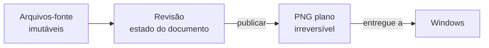
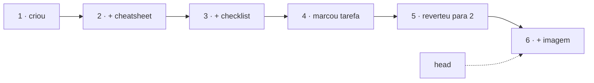

# 03 — Formato de projeto (wallpaper dinâmico)

Um wallpaper dinâmico é **uma pasta comum**. Nenhum formato binário ou banco de dados: dá para abrir no
Explorer, ler os JSONs e copiar para outro disco. O projeto não sabe nada sobre monitores (a atribuição
fica no estado da máquina, ver [02 — Arquitetura](02-arquitetura.md#estado-do-app)).

## A regra central



**O PNG nunca é editado nem desfeito.** Toda mudança nasce no projeto, e publicar gera um PNG novo. O
projeto é a fonte da verdade; o PNG é só um resultado descartável.

## Estrutura

```text
Minha mesa/
├─ project.json
├─ composition.json        as camadas atuais, em ordem; só para consulta
├─ assets/
│  ├─ 3fa9c1…e2.jpg        fundo
│  ├─ 81b07d…4c.png        imagem adicionada
│  └─ c4d210…9a.png        cheatsheet de LINQ
├─ revisions/
│  ├─ 000001.json
│  ├─ 000002.json
│  └─ 000003.json
└─ .lock                   aberto com acesso exclusivo enquanto o projeto é editado
```

Como o `.lock` é mantido aberto com acesso exclusivo, e não apenas por existir, o Windows o libera mesmo
que o app caia.

## `project.json`

O único arquivo mutável.

```json
{
  "formatVersion": 1,
  "id": "5d0c7d36-5d1b-4b6a-9d7e-0b6f3d7f1a10",
  "name": "Minha mesa",
  "canvas": { "width": 2560, "height": 1080 },
  "head": 3,
  "createdAt": "2026-11-06T18:00:00Z"
}
```

| Campo | Significado |
|---|---|
| `formatVersion` | Versão deste formato. Uma versão desconhecida é recusada, nunca lida por tentativa |
| `canvas` | Tamanho do documento. Normalmente vem do monitor escolhido na criação, mas não se liga a ele |
| `head` | Número da revisão atual |

## `composition.json`

Um resumo legível das camadas atuais, para quem abre a pasta: o fundo e cada camada, numeradas de baixo para cima,
com o arquivo em `assets/` e o nome original. Serve para saber qual arquivo é qual, já que os assets são nomeados
pelo conteúdo.

**O app nunca lê este arquivo.** Ele é gerado a cada alteração e ao abrir o projeto, e editá-lo ou apagá-lo não muda
nada. Assim, não existem duas fontes da verdade.

## `assets/`

Os **arquivos-fonte**. Cada arquivo importado é **copiado** para o projeto e nomeado pelo SHA-256 do
conteúdo, mantendo a extensão.

- **O projeto é autossuficiente:** apagar o arquivo original não afeta nada.
- **Importar o mesmo arquivo duas vezes** não duplica.
- **Assets são imutáveis.** Importar uma versão nova de um cheatsheet cria um asset novo; o anterior continua
  lá, pois revisões antigas apontam para ele.
- **O app não observa arquivos externos.** Se o arquivo de origem mudar, nada acontece até o usuário
  importar de novo, o que está de acordo com a regra de que só o app altera o wallpaper.

## `revisions/`

Cada arquivo é uma revisão **imutável**, com o estado **completo** do documento. Nada precisa ser
reexecutado para abrir uma revisão.

```json
{
  "number": 3,
  "parent": 2,
  "createdAt": "2026-11-06T18:04:12Z",
  "change": { "kind": "item-added", "itemId": "chk-1", "label": "Adicionou checklist \"Hoje\"" },
  "document": {
    "background": {
      "source": { "asset": "3fa9c1…e2.jpg", "originalName": "montanha.jpg" },
      "fit": "fill"
    },
    "items": [
      {
        "id": "ref-1",
        "type": "image",
        "rect": { "x": 40, "y": 40, "width": 900, "height": 1000 },
        "rotation": 0,
        "source": { "asset": "c4d210…9a.png", "originalName": "linq-cheatsheet.png" },
        "opacity": 1.0
      },
      {
        "id": "img-1",
        "type": "image",
        "rect": { "x": 1850, "y": 575, "width": 600, "height": 450 },
        "rotation": -4,
        "source": { "asset": "81b07d…4c.png", "originalName": "gato.png" },
        "opacity": 1.0
      },
      {
        "id": "chk-1",
        "type": "checklist",
        "rect": { "x": 1000, "y": 40, "width": 620, "height": 360 },
        "rotation": 0,
        "title": "Hoje",
        "entries": [
          { "id": "e1", "text": "Revisar a documentação", "done": true },
          { "id": "e2", "text": "Testar SetWallpaper", "done": false }
        ],
        "style": { "font": "Segoe UI", "size": 22, "color": "#FFFFFF", "panel": "#BE101218" }
      }
    ]
  }
}
```

Os itens são desenhados **na ordem da lista**: o último fica por cima.

### Tipos de item

| `type` | Serve para | Campos próprios |
|---|---|---|
| `image` | Cheatsheets e qualquer imagem adicionada à composição | `source`, `opacity`, `mirrored` |
| `checklist` | Listas de tarefas | `title`, `entries`, `style` |
| `text` | Texto livre, com várias linhas | `text`, `align`, `bold`, `italic`, `style` |
| `counter` | Um número inteiro com rótulo | `label`, `value`, `style` |
| `progress` | Uma porcentagem de 0 a 100, com rótulo | `label`, `percent`, `style` |
| `toggle` | Dois estados, cada um com seu texto | `label`, `on`, `onText`, `offText`, `style` |

Os três últimos são **controles**: o valor deles muda com um clique no editor, e o PNG mostra só o valor. Nada no
arquivo guarda os botões do editor.

Todos têm `id`, `rect` (em pixels do canvas) e `rotation` (em graus). Conteúdo maior que `rect` é recortado.

Reduzir um cheatsheet pode torná-lo ilegível, e por isso o editor oferece o tamanho real (100%) e avisa ao
reduzir. Um `rect` do mesmo tamanho do arquivo mantém a imagem pixel a pixel.

Em `text`, as quebras de linha são sempre `\n`, e o texto não pode ficar vazio: para tirá-lo, remove-se a camada.
`align` é `left`, `center`, `right` ou `justify`; ausente, é automático: centralizado em um balão de pensamento e à
esquerda nos outros painéis. `bold` e `italic` valem para o texto inteiro da camada, já que texto formatado por palavra
está fora do escopo.
Tudo o que é feito de texto cresce sozinho, na mesma revisão, quando o conteúdo deixa de caber, mas nunca encolhe
sozinho. Em `toggle`, nenhum dos dois textos pode ficar vazio.

As fontes de `style` são referenciadas pelo nome e vêm do sistema; se faltar uma, o app avisa e usa uma alternativa.

As cores são `#RRGGBB` ou `#AARRGGBB`. A opacidade do texto e a do painel são o alfa de `color` e de `panel`, sem
campos separados, para que a transparência tenha uma única fonte.

Em `style`, `shape` é o formato do painel (`rounded`, `speech` ou `thought`) e `tail` o lado da ponta de um balão
(`left` ou `right`). Projetos salvos antes desses campos abrem com painel arredondado.

Em `image`, `mirrored` espelha a imagem da esquerda para a direita, antes de girar.

### `change`

Descrição da mudança, usada na tela de histórico:

| `kind` | Quando |
|---|---|
| `created` | Criação do projeto |
| `item-added` / `item-removed` | Item adicionado ou removido |
| `item-edited` | Item movido, redimensionado, reordenado ou alterado |
| `checklist-entry-added` / `-removed` / `-toggled` / `-edited` | Mudança em uma tarefa |
| `value-changed` | Valor de um contador, barra ou alternância |
| `background-changed` | Troca do fundo |
| `reverted` | Reversão; inclui `target`, o número da revisão restaurada |
| `item-restored` | Item trazido de uma revisão antiga; inclui `fromRevision` |

Uma revisão nasce ao **concluir** uma ação: soltar o mouse ao arrastar um item ou a barra de progresso, e não a cada
pixel movido. Cada clique em − ou + é uma revisão.

## Como o histórico funciona

O histórico é **linear e só cresce**. Reverter não apaga nada; cria uma revisão nova com o documento da
revisão escolhida:



Mesmo depois de reverter para a revisão 2, as revisões 3 e 4 continuam existindo, com a checklist. Há duas
formas de recuperar algo:

- **Reverter:** o documento inteiro volta àquele estado.
- **Restaurar item:** só um item daquela revisão volta para o documento atual, sem afetar o resto. Ele retorna ao seu
  lugar na pilha: logo acima do item mais próximo que estava abaixo dele naquela revisão e ainda existe.

Nem alterar nem publicar reescrevem revisões anteriores.

Decisão e alternativas no [ADR 0004](adr/0004-composicao-recriavel.md).

## Refazer a composição

Renderizar é uma função sem efeitos colaterais: `documento + assets + tamanho → bitmap`. Não há estado
guardado entre execuções, e por isso qualquer revisão pode gerar um wallpaper a qualquer momento.

**[Medido]** Recompor uma cena de exemplo leva cerca de 0,5 s (ver
[ADR 0005](adr/0005-renderizacao-com-wpf.md#medição)).

## Custo em disco

| O quê | Tamanho | Observação |
|---|---|---|
| Uma revisão | **1,57 KiB em média [Medido]**, em um projeto com 2 itens e 19 revisões | Mil revisões ocupam cerca de 1,5 MiB; o tamanho cresce com o número de itens |
| Assets | O tamanho dos originais | O maior custo real, e só cresce ao importar algo novo |

O PNG publicado **não** fica no projeto.

## Escrita segura

Uma queda de energia durante uma alteração não pode corromper o projeto:

1. Gravar `revisions/.tmp-<id>.json`, com flush em disco.
2. Renomear para `revisions/000004.json`. Essa etapa é atômica no mesmo volume.
3. Gravar `project.json` em um arquivo temporário e substituir o atual, apontando o head para a revisão 4.

Interrompido antes da etapa 2, resta um `.tmp-*`, descartado ao abrir. Interrompido entre 2 e 3, a revisão
existe, mas o head aponta para a anterior: nada se perdeu, e ao abrir o app adota a revisão mais nova, avisando na
tela. O mesmo vale se a revisão do head estiver danificada: o app abre na revisão legível mais recente, e a
danificada continua na lista, sem ser sobrescrita. Todos esses casos têm testes em `ProjectTests`.

## Compatibilidade

Caminhos dentro do projeto são sempre relativos, para que a pasta possa ser movida. Mudanças incompatíveis
aumentam `formatVersion`, com uma migração explícita.

## Local padrão

Pasta sugerida ao criar um projeto: `%USERPROFILE%\Documents\WallpaperEditor\`. O usuário pode escolher outra.
