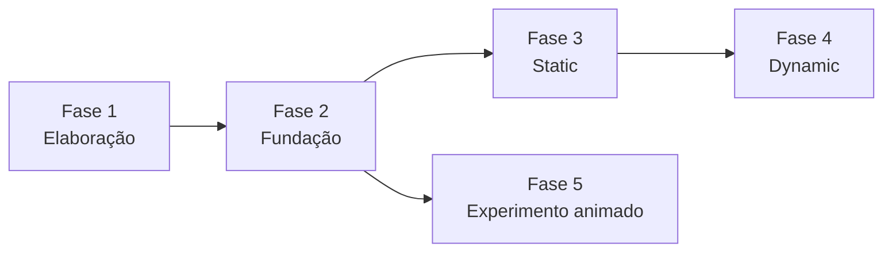

# 06 — Roadmap

Cada fase termina em algo que pode ser usado ou medido, com um critério verificável.

A Fase 5 depende apenas da Fase 2. Ela pode acontecer antes da 3 ou da 4, ou em paralelo.

## Fase 1 — Elaboração (atual)

Especificação, arquitetura e decisões documentadas.

- [x] Visão, tipos e fora de escopo
- [x] Arquitetura e divisão dos projetos
- [x] Formato de projeto
- [x] Sondagem somente leitura desta máquina
- [x] Protocolo do experimento
- [x] Protótipo descartável da renderização com WPF ([resultado](adr/0005-renderizacao-com-wpf.md#medição))
- [x] Perguntas respondidas

## Fase 2 — Fundação (concluída)

Criar a solução e provar a parte essencial: mudar um único monitor.

- [x] `WallpaperEditor.slnx`, `global.json`, `Directory.Build.props` (nullable, warnings como erros,
  mesmo padrão dos outros projetos em `dev/`), repositório git
- [x] `Core` com o modelo de monitores, e 10 testes automatizados
- [x] `Platform.Windows`: enumerar (filtrando fantasmas), nomes amigáveis, aplicar, ler estado
- [x] `App` mínimo: lista de monitores e um botão "escolher imagem"
- [x] `tools/WallpaperEditor.Diagnostics` e `scripts/measure-swap.ps1`, para refazer as medições
- [x] [Custo de trocar o wallpaper](04-integracao-windows.md#custo-de-trocar-o-wallpaper) medido
- [x] Testes T3, T4 e T6 confirmados na tela pelo usuário
- [x] Wallpaper original restaurado, e VRAM medida de novo

**Critério:** a tela mostra exatamente 3 monitores com os nomes certos e aplica uma imagem em um deles sem
alterar os outros dois. A tela foi conferida por UI Automation.

**Limites do que foi testado:** só o monitor vertical recebeu escrita, de propósito, pela ferramenta de
diagnóstico, que usa o mesmo serviço do app. O botão "Escolher imagem" do app ainda não foi clicado, e esta tela
será substituída na Fase 3.

## Fase 3 — Static (implementada)

- [x] `Rendering`: decodificar, respeitar a orientação EXIF, ajustar à resolução do monitor, codificar PNG
- [x] `WallpaperPublisher` e `state.json`: atribuições, wallpaper original, restaurar
- [x] Tela completa: mapa dos monitores, arquivo, modo de ajuste, pré-visualização
- [x] Avaliar `NekoLib.Navigation.Wpf`: é voltada a navegação em camadas para kiosk e PDV, e seria peso sem uso em
  um app de uma ou duas telas. Escolhido `CommunityToolkit.Mvvm`
- [x] Tratamento de erros: modo span, slideshow, monitor desconectado, resolução alterada, imagem ilegível
- [x] Ícone do app
- [x] Medir as [metas de leveza](01-visao-do-produto.md#só-o-app-altera-o-wallpaper)
- [x] 61 testes automatizados; publicação real testada no monitor vertical, pela ferramenta de diagnóstico
- [ ] **Usuário:** usar a tela de verdade: escolher imagem, aplicar e restaurar nos 3 monitores

**Concluída quando** cada um dos 3 monitores puder ter uma imagem e um modo de ajuste diferentes, o
"restaurar original" devolver o estado anterior, e as metas de leveza estiverem medidas.

**Limites do que foi testado:** o botão "Aplicar" e o seletor de arquivo ainda não foram usados na tela, e não há
testes automatizados dos view models. O modo span e a mudança de resolução só foram exercitados com dublês, não no
Windows real.

## Fase 4 — Dynamic (implementada, em conferência)

**Falta o usuário testar:** arrastar, redimensionar e girar itens com o mouse, e criar um projeto novo com os
diálogos de arquivo. O resto foi exercitado de verdade: por 134 testes automatizados e, na tela, por UI Automation
(selecionar itens, publicar, marcar tarefas, remover, restaurar um item e reverter). Esses passos não usaram o mouse
nem os diálogos de arquivo. A publicação real foi só no monitor vertical. Mudar um projeto para outro formato de
monitor só foi testado no `Rendering`.

Em duas etapas, com o motor primeiro:

**4a — Motor, sem interface**
- Pasta de projeto, leitura e escrita, recuperação de falhas
- Documento e histórico: adicionar, editar e remover itens, reverter, restaurar um item
- Renderização dos dois tipos de item: imagem e checklist (com recorte, e caixas de seleção desenhadas como
  geometria)
- Testes automatizados de tudo isso
- Medir o custo real em disco: [1,57 KiB por revisão](03-formato-de-projeto.md#custo-em-disco)

**4b — Editor**
- Abrir e criar projeto; reabrir o último usado
- Adicionar, mover, redimensionar, girar e reordenar itens
- Opção de tamanho real (100%) para imagens, com aviso ao reduzir, para cheatsheets continuarem legíveis
- Editar checklist: adicionar, remover e marcar tarefas
- Painel de histórico, com a descrição de cada mudança e miniaturas
- Lista de itens, para alcançar um item escondido atrás de outro e usar sem mouse
- Publicar em um monitor, mostrando quando o head está à frente do que foi publicado; marcar uma tarefa publica
  sozinho, se o projeto já estiver naquele monitor

**Concluída quando** for possível, nos 3 exemplos de uso (cheatsheet, checklist, imagens):
criar um projeto, publicar, alterar, publicar de novo, reverter, restaurar um item removido, fechar, mover a
pasta e reabrir com tudo intacto. Com o app fechado, nenhum processo fica rodando.

## Fase 5 — Experimento do modo animado

- Testes de viabilidade A1 a A3. Uma falha aqui encerra a fase
- `AnimatedHost` mínimo: um vídeo, um monitor, loop
- Script de coleta e vídeos de teste
- Rodar a matriz e preencher os [resultados](05-experimento-animado.md#resultados)
- Tomar a decisão pelo [critério definido](05-experimento-animado.md#critério-de-decisão)

**Concluída quando** houver um relatório com números e uma decisão registrada em um novo ADR.

## Testes de validação

Hipóteses da [integração com o Windows](04-integracao-windows.md) que precisam de verificação no
desktop real. Elas **alteram o wallpaper** e só escrevem no monitor vertical, encontrado pelo formato. O
wallpaper atual é salvo antes e restaurado depois (comandos `snapshot` e `restore` da ferramenta de
diagnóstico).

### Static (Fase 2)

| # | Teste | Resultado | Situação |
|---|---|---|---|
| T1 | Enumerar monitores filtrando por retângulo | Exatamente os 3 reais, dos 5 listados | **Passou** |
| T2 | `monitorDevicePath` é igual ao ID de `IDesktopWallpaper` | Iguais nos 3 monitores | **Passou** |
| T3 | `SetWallpaper` em um monitor | `GetWallpaper` dos outros 2 não mudou em nenhuma das 20+ trocas, e na tela eles não mudaram nem piscaram | **Passou** |
| T4 | Reescrever o arquivo e chamar `SetWallpaper` com o mesmo caminho | O cache recebe os pixels novos, e a tela mostra `TESTE B` | **Passou** |
| T5 | PNG em resolução nativa, comparado com a cópia do Windows | 0 de 2.073.600 pixels diferentes | **Passou** |
| T6 | Monitor vertical e posição global `FILL` | Reportado como 1080×1920; na tela, borda magenta nos 4 lados e quadriculado de 1 px visível | **Passou** |

### Animated (Fase 5)

| # | Teste | Resultado esperado | Se falhar |
|---|---|---|---|
| A1 | Procedimento de anexação na topologia elevada, com e sem `0x052C` | Janela colorida atrás dos ícones, no monitor certo | Encerrar o experimento e registrar o motivo |
| A2 | Reiniciar o Explorer com a janela anexada | Reanexa sozinha | Investigar; bloqueia a aprovação |
| A3 | `SetWallpaper` em outro monitor com o vídeo rodando | Vídeo continua, e o outro monitor muda | Reanexar após cada publicação; se não houver como, documentar a limitação |

## Depois

Sem compromisso, para reavaliar se houver uso real: item de texto, descarte manual de revisões e assets
antigos, publicar o mesmo projeto em vários monitores, [clicar no próprio
wallpaper](04-integracao-windows.md#clicar-no-próprio-wallpaper).
