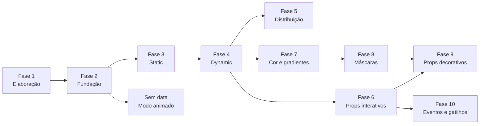

# 06 — Roadmap

Cada fase termina em algo que pode ser usado ou medido, com um critério verificável.



As fases 5, 6 e 7 dependem só da 4 e podem andar em paralelo. A 8 usa os gradientes da 7 como máscara, e a 9 usa as
cores, formas e máscaras das anteriores. A 10 se apoia nos props da 6, como a garrafa e o seletor de estado, para ter
o que acionar; as etapas de tecla de atalho e linha de comando podem vir antes. As versões são previstas, sem data. O modo animado não tem data nem versão: é
um experimento, e fica por último.

| Fase | Versão prevista | Situação |
|---|---|---|
| 1 a 4 | — | Concluídas; a 4 em conferência |
| 5 — Distribuição | v0.1.0 | A fazer |
| 6 — Props interativos | v0.2 | A fazer |
| 7 — Cor e gradientes | v0.3 | A fazer |
| 8 — Máscaras e cor por máscara | v0.4 | A fazer |
| 9 — Props decorativos | v0.5 | A fazer |
| 10 — Eventos e gatilhos do companion | v0.6 | A fazer |
| Modo animado | Sem data nem versão | Experimento em andamento |

## Fase 1 — Elaboração (concluída)

Especificação, arquitetura e decisões documentadas.

- [x] Visão, tipos e fora de escopo
- [x] Arquitetura e divisão dos projetos
- [x] Formato de projeto
- [x] Sondagem somente leitura desta máquina
- [x] Protocolo do experimento
- [x] Protótipo descartável da renderização com WPF ([resultado](adr/0005-renderizacao-com-wpf.md#medição))
- [x] Perguntas respondidas

## Fase 2 — Fundação (concluída)

Criar a solução e provar a parte essencial: mudar um único monitor.

- [x] `WallpaperEditor.slnx`, `global.json`, `Directory.Build.props` (nullable, warnings como erros,
  mesmo padrão dos outros projetos em `dev/`), repositório git
- [x] `Core` com o modelo de monitores, e 10 testes automatizados
- [x] `Platform.Windows`: enumerar (filtrando fantasmas), nomes amigáveis, aplicar, ler estado
- [x] `App` mínimo: lista de monitores e um botão "escolher imagem"
- [x] `tools/WallpaperEditor.Diagnostics` e `scripts/measure-swap.ps1`, para refazer as medições
- [x] [Custo de trocar o wallpaper](04-integracao-windows.md#custo-de-trocar-o-wallpaper) medido
- [x] Testes T3, T4 e T6 confirmados na tela pelo usuário
- [x] Wallpaper original restaurado, e VRAM medida de novo

**Critério:** a tela mostra exatamente 3 monitores com os nomes certos e aplica uma imagem em um deles sem
alterar os outros dois. A tela foi conferida por UI Automation.

**Limites do que foi testado:** só o monitor vertical recebeu escrita, de propósito, pela ferramenta de
diagnóstico, que usa o mesmo serviço do app. O botão "Escolher imagem" do app ainda não foi clicado, e esta tela
será substituída na Fase 3.

## Fase 3 — Static (implementada)

- [x] `Rendering`: decodificar, respeitar a orientação EXIF, ajustar à resolução do monitor, codificar PNG
- [x] `WallpaperPublisher` e `state.json`: atribuições, wallpaper original, restaurar
- [x] Tela completa: mapa dos monitores, arquivo, modo de ajuste, pré-visualização
- [x] Avaliar `NekoLib.Navigation.Wpf`: é voltada a navegação em camadas para kiosk e PDV, e seria peso sem uso em
  um app de uma ou duas telas. Escolhido `CommunityToolkit.Mvvm`
- [x] Tratamento de erros: modo span, slideshow, monitor desconectado, resolução alterada, imagem ilegível
- [x] Ícone do app
- [x] Medir as [metas de leveza](01-visao-do-produto.md#só-o-app-altera-o-wallpaper)
- [x] 61 testes automatizados; publicação real testada no monitor vertical, pela ferramenta de diagnóstico
- [ ] **Usuário:** usar a tela de verdade: escolher imagem, aplicar e restaurar nos 3 monitores

**Concluída quando** cada um dos 3 monitores puder ter uma imagem e um modo de ajuste diferentes, o
"restaurar original" devolver o estado anterior, e as metas de leveza estiverem medidas.

**Limites do que foi testado:** o botão "Aplicar" e o seletor de arquivo ainda não foram usados na tela, e não há
testes automatizados dos view models. O modo span e a mudança de resolução só foram exercitados com dublês, não no
Windows real.

## Fase 4 — Dynamic (implementada, em conferência)

**Testado pelo usuário em 2026-11-15:** clicar nos componentes na pré-visualização, arrastar e redimensionar,
publicar uma checklist sobre uma foto em um monitor de verdade, balões de fala e de pensamento, espelhar uma imagem, e
a pergunta ao sair.

**Falta testar:** "Atualizar e sair" ao fechar, e criar um projeto novo com os diálogos de arquivo, conferido só
indiretamente; e as alças nos lados, só por testes da geometria. O resto foi exercitado de verdade: por 257 testes
automatizados (incluindo onde cada componente pode ser clicado, também com o item girado) e, na tela, por UI Automation
(selecionar itens, publicar, marcar tarefas, remover, restaurar um item, reverter, trocar a fonte, mudar as
opacidades, criar e editar texto, criar e mudar contador, barra e alternância pelo painel, e criar um projeto a partir do
wallpaper atual, cujo fundo saiu idêntico ao arquivo do monitor). Esses passos não usaram o
mouse nem os diálogos de arquivo. A publicação real foi só no monitor vertical. Mudar um projeto para outro formato de
monitor só foi testado no `Rendering`.

Em duas etapas, com o motor primeiro:

**4a — Motor, sem interface**
- Pasta de projeto, leitura e escrita, recuperação de falhas
- Documento e histórico: adicionar, editar e remover itens, reverter, restaurar um item
- Renderização dos dois tipos de item: imagem e checklist (com recorte, e caixas de seleção desenhadas como
  geometria)
- Testes automatizados de tudo isso
- Medir o custo real em disco: [1,57 KiB por revisão](03-formato-de-projeto.md#custo-em-disco)

**4b — Editor**
- Abrir e criar projeto; reabrir o último usado
- Criar um projeto a partir do wallpaper atual do monitor (**Editar wallpaper atual**), com uma cópia dele como fundo
- Adicionar, mover, redimensionar, girar e reordenar itens
- Opção de tamanho real (100%) para imagens, com aviso ao reduzir, para cheatsheets continuarem legíveis
- Editar checklist: adicionar, remover e marcar tarefas
- Camada de texto livre, com várias linhas
- Fonte, tamanho e opacidade do texto e do painel, em checklists e textos
- Painel de histórico, com a descrição de cada mudança e miniaturas
- Lista de itens, para alcançar um item escondido atrás de outro e usar sem mouse
- Publicar em um monitor pelo botão **Atualizar wallpaper**, mostrando quando o head está à frente do que foi publicado
- Contador, barra de progresso e alternância
- Painel arredondado, balão de fala ou balão de pensamento; espelhar imagens
- Alças nos lados, para mudar só a largura ou só a altura
- Alinhamento, negrito e itálico no texto livre
- Perguntar ao sair, se houver mudanças que o wallpaper ainda não mostra
- Componentes clicáveis na pré-visualização: tarefas, − e + do contador, barra arrastável e alternância
- Companion ([ADR 0007](adr/0007-companion-residente.md)): ícone na área de notificação e janela de interação, aberta
  também pelo botão **Interagir**, em que cada clique atualiza o wallpaper; inicia com o Windows só enquanto houver
  um wallpaper dinâmico na tela

**Concluída quando** for possível, nos 3 exemplos de uso (cheatsheet, checklist, imagens):
criar um projeto, publicar, alterar, publicar de novo, reverter, restaurar um item removido, fechar, mover a
pasta e reabrir com tudo intacto. Com o app fechado, nenhum processo fica rodando além do companion, e ele sai quando
nenhum monitor mostra um projeto.

**Companion, testado sem clicar** (um clique trocaria um wallpaper real): abre a janela do projeto do monitor, um
segundo pedido reaproveita a mesma janela e o processo extra termina, o projeto fica preso só com a janela aberta, e
`exit` pelo pipe encerra tudo.

**Testado pelo usuário em 2026-11-15:** clicar nos componentes pela janela do companion, com o wallpaper trocando a cada
clique; o ícone, o menu e a dica; e o wallpaper publicado continuando na tela depois de reiniciar o computador, já que é
só uma imagem do Windows. Depois, com os dados reais (sem `--data`), o companion se registrou ao abrir o app e voltou
sozinho depois de reiniciar, com as mudanças feitas por ele.

## Fase 5 — Distribuição

**Versão prevista:** v0.1.0, o que já existe, empacotado.

Hoje o projeto só existe nesta máquina: sem remoto, sem CI, sem release. E o companion se registra para iniciar com o
Windows apontando para `bin\Debug`, que some com um `dotnet clean`.

- [ ] Repositório no GitHub, com este README e os documentos como estão
- [ ] CI no GitHub Actions (`windows-latest`): `dotnet build` e `dotnet test`, com avisos como erros, como aqui. Os
  testes do `Rendering` precisam de WPF, que o runner Windows tem
- [ ] Versão SemVer em `Directory.Build.props`, mostrada na janela, e um `CHANGELOG.md`
- [ ] Release a partir de uma tag `v*`: `dotnet publish` framework-dependent num `.zip`, com o hash SHA-256 ao lado
- [ ] **Instalador**, para o app e o companion nunca apontarem para `bin` ou `obj`:
  - instala por usuário em `%LOCALAPPDATA%\Programs\WallpaperEditor`, sem administrador, com atalho no menu Iniciar;
  - verifica se o .NET Desktop Runtime 10 está instalado, e indica onde baixá-lo se faltar;
  - numa atualização, fecha o app e o companion antes de trocar os arquivos e reabre o companion se havia um wallpaper
    dinâmico, regravando o registro de inicialização no caminho instalado;
  - aparece em Configurações → Aplicativos, e desinstalar fecha o companion, tira o registro de inicialização e
    pergunta se apaga os dados (`%LOCALAPPDATA%\WallpaperEditor`). Os projetos em Documentos nunca são apagados;
  - gerado pelo workflow de release junto com o `.zip`. Candidatos: **Inno Setup**, simples e por usuário, ou
    **MSIX**, que dá identidade de pacote (notificações com botões, tarefa de inicialização nativa) mas exige assinar
    o pacote
- [ ] Um build Debug não se registra para iniciar com o Windows, para não deixar uma entrada apontando para o repositório

**Concluída quando** uma tag gerar o instalador e o `.zip` no Release, e o app instalado por ele publicar um projeto,
registrar o companion no caminho instalado, e o companion voltar depois de reiniciar. Desinstalar não pode deixar
processo nem entrada de inicialização para trás.

## Fase 6 — Props interativos

**Versão prevista:** v0.2.

Componentes novos, todos no mesmo modelo dos atuais: o valor muda com um clique no editor ou no companion, e o PNG
mostra só o resultado. Nada muda sozinho, nem com o relógio.

| Prop | O que mostra | Como se interage |
|---|---|---|
| **Rastreador de hábitos** | Uma grade de hábitos por dias da semana | Clicar no quadrado marca ou desmarca o dia; "Nova semana" limpa a grade e guarda a anterior no histórico |
| **Corrente do mês** | Um calendário do mês, com os dias cumpridos riscados, para não quebrar a sequência | Clicar no dia risca; o mês muda à mão, com ‹ e › |
| **Pips** | Uma fileira de N bolinhas ou tomates, como pomodoros do dia | Clicar na quinta preenche até a quinta; clicar na última preenchida esvazia |
| **Anel de progresso** | A barra de progresso em forma de anel, com a porcentagem no meio | Arrastar em volta do anel |
| **Seletor de estado** | Uma de várias opções, cada uma com sua cor: Foco, Reunião, Pausa, Livre. Generaliza a alternância | Clicar troca para o próximo estado, ou no estado desejado |
| **Humor e energia** | Uma escala de 1 a 5, em estrelas, rostinhos ou barras | Clicar no nível |
| **Garrafa d'água** | Uma garrafa que enche um copo por vez, até a meta | Clicar adiciona um copo; "Zerar" começa outro dia |
| **Placar** | Dois ou mais contadores lado a lado, como vitórias e derrotas | − e + em cada um |
| **Meta em valor** | Um termômetro como "R$ 1.200 de R$ 5.000", para uma meta de economia | Campo de valor no painel; + com um passo escolhido |
| **Dias desde** | "12 dias sem açúcar", contado à mão, não pelo relógio | +1 por dia e "Zerar" |
| **Kanban mínimo** | Três colunas, A fazer, Fazendo e Feito, com cartões curtos | Clicar no cartão o leva para a próxima coluna |
| **Top 3 do dia** | Só três prioridades, numeradas e grandes | Clicar risca; "Novo dia" limpa |
| **Frase da vez** | Uma frase de uma lista sua, como lembretes ou citações | › mostra a próxima. Sem sorteio: as imagens e frases são sempre escolhidas |
| **Estante** | Livros, séries ou cursos, com capa pequena, estado e progresso | Clicar troca o estado: quero, em andamento, terminei |
| **Pinos sobre imagem** | Marcadores numerados por cima de uma imagem, com legenda ao lado, para um mapa ou diagrama | Clicar no pino marca como visto |

Cada um precisa, como os atuais: geometria dos pontos clicáveis com o item girado, descrição no histórico, controle no
painel lateral para usar sem mouse, e testes de onde clicar.

**Concluída quando** os props estiverem no editor e no companion, com testes, e um projeto de exemplo usar pelo menos
cinco deles.

## Fase 7 — Cor e gradientes

**Versão prevista:** v0.3.

Hoje a cor do texto e do painel é sólida, e só a opacidade é editável. Esta fase traz cor de verdade.

**Cor sólida**
- [ ] Seletor de cor para o texto, o painel e o contorno, com alfa, hexadecimal e conta-gotas que pega da imagem de
  fundo
- [ ] Paleta do projeto: cores com nome, reaproveitadas pelos itens, para trocar o tema inteiro de uma vez
- [ ] Aviso de contraste, quando o texto fica ilegível sobre o painel ou sobre o fundo

**Gradientes**

| O quê | Como |
|---|---|
| Tipos | Linear, com ângulo; radial, com centro e raio, também elíptico; cônico, girando em volta de um ponto; e de quatro cantos, uma cor em cada canto |
| Paradas | Quantas forem precisas, cada uma com cor, alfa e posição, arrastadas numa barra |
| **Curva entre paradas** | Linear, suave, *ease-in*, *ease-out*, ou uma **curva Bézier cúbica editável**, com dois pontos de controle, como `cubic-bezier` no CSS. Cada trecho entre duas paradas tem a sua |
| **Inclinação** | Um ponto médio por trecho, que decide onde a transição acontece, e uma dureza, de suave a corte seco |
| Degraus | Posterizar em N faixas, para um visual retrô ou de mapa de calor |
| Espaço de cor | sRGB, como hoje, ou **OKLab**, que não deixa um cinza sujo no meio de duas cores complementares |
| Repetição | Parar na última cor, repetir ou espelhar |
| Pontilhado (*dither*) | Ligado por padrão: o PNG é de 8 bits, e um gradiente suave em 8 bits forma faixas visíveis num monitor grande |

Onde um gradiente pode entrar: o **fundo** (sem imagem, ou por cima dela), o preenchimento do painel, o texto, o
contorno, uma **vinheta** nas bordas, e, na Fase 8, uma máscara.

**[Hipótese]** Os pincéis do WPF só interpolam em linha reta e sem pontilhado. Curvas, OKLab e pontilhado exigem
calcular o gradiente pixel a pixel num bitmap, a ser medido pelas mesmas metas de leveza: publicar em até 1 s.

**Concluída quando** um fundo só de gradiente, com uma curva Bézier, sair no PNG sem faixas visíveis no ultrawide, e
o editor, o companion e o wallpaper mostrarem as mesmas cores.

## Fase 8 — Máscaras e cor por máscara

**Versão prevista:** v0.4.

Máscaras escondem ou mostram parte de um item; o controle de cor por máscara muda a cor só ali. Tudo é **não destrutivo**:
a revisão guarda os parâmetros, nunca pixels, e o asset continua intacto, como pede o
[ADR 0004](adr/0004-composicao-recriavel.md).

**Máscaras**

| Tipo | Para quê |
|---|---|
| Forma | Retângulo arredondado, elipse, estrela, coração, polígono por cliques. Foto em círculo, recorte de personagem simples |
| Gradiente | A imagem desaparece aos poucos para a borda, com a curva da Fase 7 |
| Outra imagem | Usa a luminância ou o alfa de um PNG, como uma silhueta ou uma textura |
| Faixa de cor | Conta-gotas, tolerância e suavidade: seleciona o céu de uma foto, ou some com o fundo branco de um cheatsheet |
| Texto | O texto vira janela para a imagem por baixo, com letras grandes "recheadas" da foto |

Todas podem ser invertidas, combinadas (união, interseção, diferença) e ter a borda suavizada.

**Cor dentro da máscara**
- Tingir com uma cor, com força ajustável
- Matiz, saturação e luminosidade, brilho e contraste
- **Cor seletiva:** tudo em preto e branco, menos a área da máscara
- **Duotone e mapa de gradiente:** as sombras e as luzes viram as cores de um gradiente da Fase 7
- Trocar uma cor por outra, pela faixa de cor
- Combinar com o que está embaixo: multiplicar, tela, sobrepor

**Fora desta fase, e ainda fora do escopo:** pintar a máscara à mão com pincel, e filtros artísticos. O app compõe;
não é um editor de imagens.

**Concluída quando** uma foto de fundo puder ter só o céu recolorido por faixa de cor, e uma imagem puder sair em
círculo com a borda esmaecida, sem nenhuma alteração nos assets e com tudo reversível pelo histórico.

## Fase 9 — Props decorativos

**Versão prevista:** v0.5.

Itens sem interação, que usam as cores, os gradientes e as máscaras das fases anteriores.

| Prop | O que é |
|---|---|
| **Nota adesiva** | Um post-it com cor, leve rotação, fita adesiva e sombra |
| **Moldura de foto** | Polaroid, cantos de álbum ou borda simples, com legenda manuscrita |
| **Formas** | Retângulo, círculo, linha, seta e chave, com preenchimento, gradiente e contorno |
| **Tabela de atalhos** | Duas colunas, tecla e ação, com as teclas desenhadas como *keycaps*: `Ctrl` `Shift` `P`. Feita para cheatsheets digitados no app |
| **Bloco de código** | Fonte monoespaçada, fundo e numeração de linhas. Sem realce de sintaxe, que continua fora do escopo |
| **QR code** | Gerado de um texto ou link, para abrir no celular |
| **Adesivo** | Um ícone ou emoji grande, com contorno branco de adesivo |
| **Carimbo** | "FEITO!" por cima de uma checklist, que aparece sozinho quando todas as tarefas estão marcadas. Só muda com um clique na checklist, não com o tempo |
| **Fita e divisor** | Faixas decorativas para separar áreas do wallpaper |

Junto, melhorias no editor que esses itens pedem: guias e encaixe ao alinhar, agrupar itens, duplicar, copiar e colar
entre projetos.

**Concluída quando** um projeto de exemplo, montado só com props desta fase e das anteriores, publicar em menos de 1 s.

## Fase 10 — Eventos e gatilhos do companion

**Versão prevista:** v0.6.

Hoje o companion só reage à própria janela. Aqui ele passa a se inscrever em dispatchers que já existem, e a ser ele
mesmo um dispatcher, para que outras coisas mudem o wallpaper. Ele não ganha um listener por fonte.

```text
fontes ──► barramento interno ──► regras ──► ação no projeto ──► CoalescingRunner ──► wallpaper
```

**Fontes, em ordem de entrada**

| Etapa | Fonte | Como se inscreve | Para quê |
|---|---|---|---|
| 1 | Tecla de atalho global | `RegisterHotKey` | Abrir a janela; ações diretas, como +1 copo ou trocar o estado |
| 1 | Linha de comando e links | O pipe que já existe; protocolo `wallpapereditor://` em `HKCU\Software\Classes` | `--do "Dias +1"` a partir de scripts, AutoHotkey, Stream Deck, Agendador de Tarefas, navegador, notas |
| 2 | `Microsoft.Win32.SystemEvents` | Eventos .NET | Resolução mudou: publicar de novo, ajustado. Sono, bloqueio, relógio mudou, tema claro ou escuro |
| 2 | Mensagens de janela | `HwndSource.AddHook` | Wallpaper trocado fora do app: sair na hora. Monitor conectado; Explorer reiniciado |
| 3 | Virada do dia e horários | Um único timer até o próximo instante, refeito ao voltar do sono | "Hoje" na corrente do mês; zerar a garrafa no novo dia; o estado às 9h e às 18h. **Opcional por prop, desligado por padrão** |
| 3 | WinRT | `UISettings`, sessão de mídia | Cor de destaque do Windows nos painéis; "Tocando agora" |
| 4 | Saída do barramento | Inscrição pelo pipe | Outros programas sabem quando um contador mudou ou uma tarefa foi marcada |
| 5 | Dados da web | `HttpClient` num intervalo escolhido, de 10 s para cima | Mostrar um dado de uma API num prop. Detalhes abaixo |

**Dados da web (etapa 5)**

Um prop **Dado da web** mostra um valor de uma API: uma cotação, a contagem de algo, o estado de um serviço, a próxima
coisa de uma lista. O companion **busca** o dado no intervalo escolhido. Se o dado vier **igual, ignora**: nada é
desenhado nem gravado. Só um dado diferente vira publicação.

Assim, o custo depende de quantas vezes o dado muda de verdade, não do intervalo. Buscar custa microssegundos de CPU e
alguns KB de rede; publicar custa cerca de 0,9 s e um PNG. Buscar a cada 10 s um dado que muda duas vezes por hora
custa duas publicações por hora.

| Regra | Por quê |
|---|---|
| **Comparar o que aparece, não o que chegou** | O prop escolhe o campo (um caminho no JSON) e o formato. Se a API manda 5,4312 e depois 5,4318, e o prop mostra "5,43", é igual. Campos que mudam sempre, como `timestamp`, nem entram |
| **Pedir só o que mudou** | Com `ETag` ou `Last-Modified`, uma resposta igual volta como `304`, sem corpo |
| **Pausar sem ninguém olhando** | Tela bloqueada, monitor desligado (`GUID_CONSOLE_DISPLAY_STATE`) ou jogo e vídeo em tela cheia (`SHQueryUserNotificationState`): não busca. Ao voltar, busca uma vez |
| **Respeitar a API** | Intervalo mínimo de 10 s; ao receber `429` ou `Retry-After`, espera o que a API pede; em erro, recua aos poucos (*backoff*) e mantém o último valor, com uma marca discreta de "desatualizado" |
| **Defesa contra rajada** | Um dado que oscila muito, como uma cotação num dia agitado, passa pelas mesmas camadas abaixo: intervalo mínimo entre publicações e disjuntor |
| **Chaves fora do projeto** | Um token de API fica guardado pelo DPAPI do Windows, nesta máquina, nunca no JSON do projeto, que pode ser copiado ou versionado |

Só GET e só JSON, na primeira versão; o prop nunca envia nada do projeto para a API.

**Regras moram no projeto.** Exemplos: "na virada do dia, zerar a garrafa" e "com a câmera ligada, estado = Em
reunião". Elas são versionadas no histórico como qualquer mudança, e um projeto sem regras se comporta exatamente como
hoje. Um evento é dado, nunca comando: cada um vira uma das ações que um clique já faz, e o pipe continua aceitando
só o usuário atual. Valores calculados, como "hoje", entram na renderização e não geram revisão. Uma mudança feita por
regra gera revisão marcada como automática.

**Ressalva: rajadas de eventos.** Uma fonte barulhenta, ou um script em loop, não pode virar o equivalente a um DDoS
contra o próprio PC. Cada publicação custa cerca de 0,9 s e um PNG novo, então o barramento se defende em camadas,
antes de chegar ao wallpaper:

| Camada | O que faz |
|---|---|
| **Agregar** | Eventos que se somam viram um só. Dez "+1" seguidos viram um "+10", e só o último estado conta ("Foco", depois "Pausa", depois "Foco" vira "Foco"). Agrega-se por item e por tipo de ação, dentro de uma janela curta |
| **Coalescer a publicação** | O `CoalescingRunner` que já existe: enquanto uma publicação roda, as próximas viram uma só no fim. O documento muda na hora; o wallpaper, no máximo uma vez por ciclo |
| **Intervalo mínimo** | Um teto de publicações automáticas, por exemplo uma a cada 2 s, por monitor. Cliques do usuário passam na frente |
| **Limite por fonte** | Um balde de fichas (*token bucket*) por fonte. Acima do limite, os eventos excedentes são descartados ou amostrados, e só o mais recente sobrevive |
| **Fila limitada** | Tamanho fixo; cheia, descarta os mais antigos do mesmo tipo, nunca trava quem publica |
| **Disjuntor** | Uma fonte que estoura o limite por tempo demais é silenciada por alguns minutos, com um aviso no ícone e no log, em vez de continuar insistindo |
| **Sem polling** | Só fontes que avisam. Inatividade, CPU e RAM ficam de fora, porque exigiriam consultar em intervalos |

Os números (janela de agregação, intervalo mínimo, tamanho do balde) começam conservadores e são ajustados por medição.

**Fora desta fase:** ETW e WNF, que exigem administrador ou não são documentados; e conexões permanentes, como MQTT,
ntfy ou SSE. Ficam em "Depois", como opção desligada.

**Concluída quando:**
- as etapas 1 e 2 funcionarem;
- uma regra de virada do dia rodar num projeto de exemplo;
- um Dado da web buscado a cada 10 s, durante uma hora, publicar só quando o valor mostrado mudar, sem publicação
  nenhuma com a tela bloqueada;
- **o teste de rajada passar**: 10.000 comandos pelo pipe em 10 s, de várias fontes ao mesmo tempo, resultarem em
  poucas publicações, com o valor final certo, o companion respondendo a cliques durante a rajada, e CPU e memória
  voltando ao repouso logo depois.

## Testes de validação

Hipóteses da [integração com o Windows](04-integracao-windows.md) que precisam de verificação no
desktop real. Elas **alteram o wallpaper** e só escrevem no monitor vertical, encontrado pelo formato. O
wallpaper atual é salvo antes e restaurado depois (comandos `snapshot` e `restore` da ferramenta de
diagnóstico).

### Static (Fase 2)

| # | Teste | Resultado | Situação |
|---|---|---|---|
| T1 | Enumerar monitores filtrando por retângulo | Exatamente os 3 reais, dos 5 listados | **Passou** |
| T2 | `monitorDevicePath` é igual ao ID de `IDesktopWallpaper` | Iguais nos 3 monitores | **Passou** |
| T3 | `SetWallpaper` em um monitor | `GetWallpaper` dos outros 2 não mudou em nenhuma das 20+ trocas, e na tela eles não mudaram nem piscaram | **Passou** |
| T4 | Reescrever o arquivo e chamar `SetWallpaper` com o mesmo caminho | O cache recebe os pixels novos, e a tela mostra `TESTE B` | **Passou** |
| T5 | PNG em resolução nativa, comparado com a cópia do Windows | 0 de 2.073.600 pixels diferentes | **Passou** |
| T6 | Monitor vertical e posição global `FILL` | Reportado como 1080×1920; na tela, borda magenta nos 4 lados e quadriculado de 1 px visível | **Passou** |

Os testes do modo animado estão na seção dele, no fim.

## Depois

Sem compromisso, para reavaliar se houver uso real: descarte manual de revisões e assets antigos, publicar o mesmo
projeto em vários monitores, [clicar no próprio wallpaper](04-integracao-windows.md#clicar-no-próprio-wallpaper).

**Props que mudariam sozinhos o tempo todo:** relógio com segundos ou minutos e uso do PC. Cada troca custa cerca de
0,9 s e uma imagem nova. O que muda raramente, como a data de hoje, e dados de uma API, que só publicam quando o valor
mostrado muda, entram pela [Fase 10](#fase-10--eventos-e-gatilhos-do-companion), sempre opcionais.

**Fontes de eventos pesadas ou permanentes:** ETW e WNF, que exigem administrador ou não são documentados; MQTT, por
exemplo pelo Home Assistant, e ntfy ou SSE, para comandar o wallpaper do celular ou receber dados sem buscar. Se entrarem, passam pelas mesmas
defesas contra rajada da Fase 10.

## Sem data — Modo animado (experimental)

**Sem data nem versão prevista.** É um experimento, com uma pergunta: quanta VRAM um vídeo `.mp4` atrás dos ícones
consome, e se vale a pena. A resposta pode ser "não vale". O app funciona por inteiro sem ele. Detalhes em
[05 — Experimento do modo animado](05-experimento-animado.md).

- [x] `AnimatedHost` mínimo: um vídeo, um monitor, loop
- [x] Script de coleta (`scripts/measure-animated.ps1`) e vídeos de teste (`scripts/make-test-videos.ps1`)
- [x] Testes de viabilidade A1 e A3
- [ ] Teste A2: reiniciar o Explorer
- [ ] Rodar a matriz em condição controlada e preencher os [resultados](05-experimento-animado.md#resultados)
- [ ] Tomar a decisão pelo [critério definido](05-experimento-animado.md#critério-de-decisão)
- [ ] Só se aprovado: ligar o `AnimatedHost` ao app, que hoje roda só por linha de comando

**Concluído quando** houver um relatório com números e uma decisão registrada em um novo ADR.

| # | Teste | Resultado | Situação |
|---|---|---|---|
| A1 | Procedimento de anexação na topologia elevada, com e sem `0x052C` | Sem a mensagem, a janela fica invisível. Com ela, cobre os 15 pontos amostrados do monitor certo, sem afetar o Full HD; na tela, ícones por cima e cliques funcionando | **Passou** |
| A2 | Reiniciar o Explorer com a janela anexada | **Primeira tentativa:** o host caiu, porque a consulta de monitores falha com o Explorer fora do ar. O Explorer e o wallpaper voltaram normalmente. Corrigido, sem novo teste; bloqueia a aprovação se falhar | **Falhou; refazer** |
| A3 | `SetWallpaper` com o vídeo rodando | O `WorkerW` é recriado por cima do vídeo; o host se recoloca em cerca de 1 s, e o wallpaper muda por baixo | **Passou, com ajuste** |

**Limite do A3:** com pixels, foi testado trocando o wallpaper do próprio monitor do vídeo, porque os testes só escrevem
no vertical. Com o vídeo em outro monitor, a tela estava coberta por uma janela: ali se confirmou o processo vivo e o
`WorkerW` recriado, mas não a imagem.
